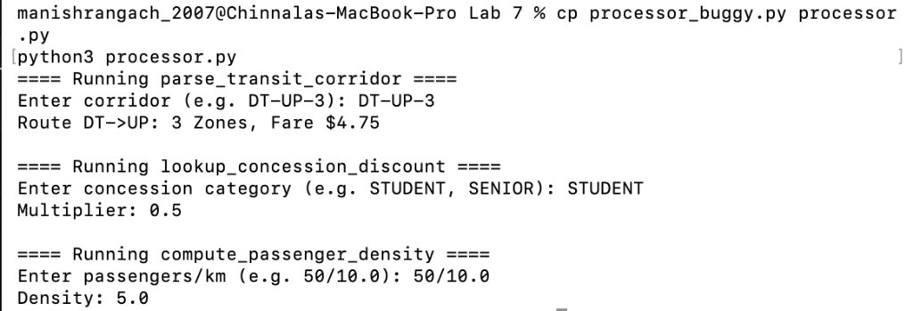
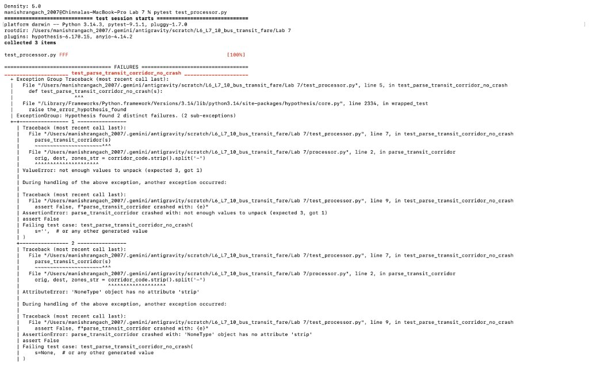
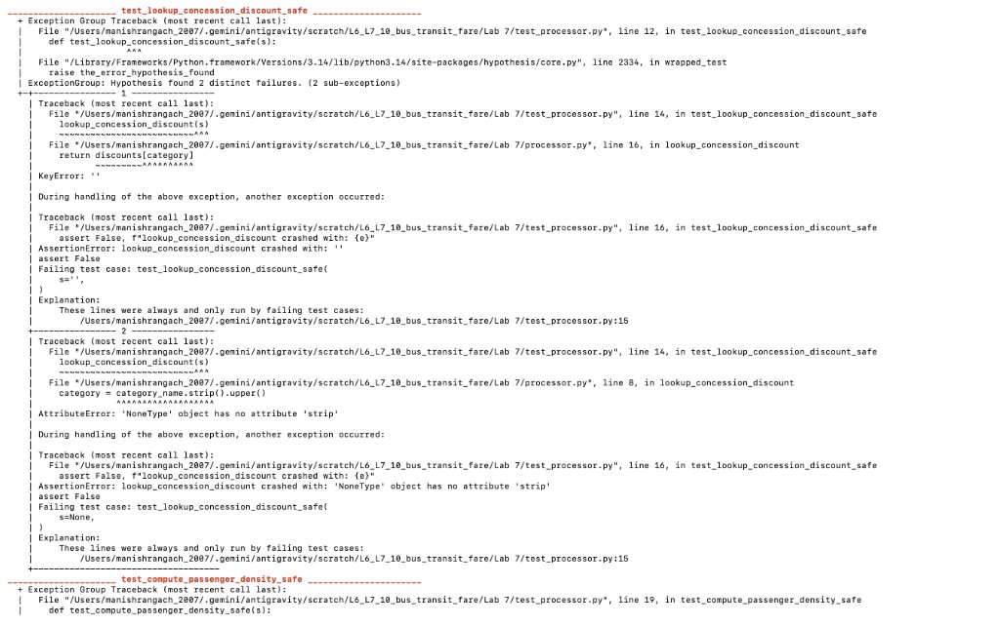
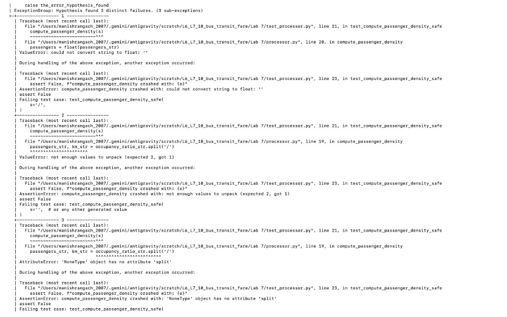
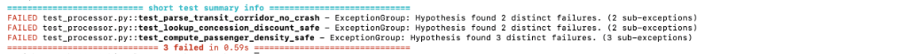
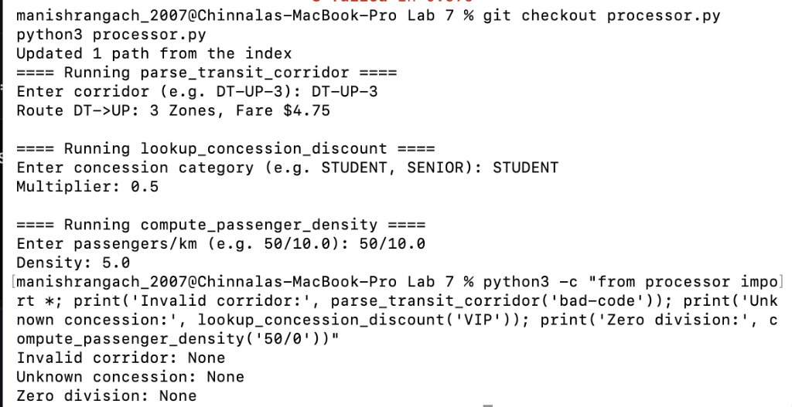
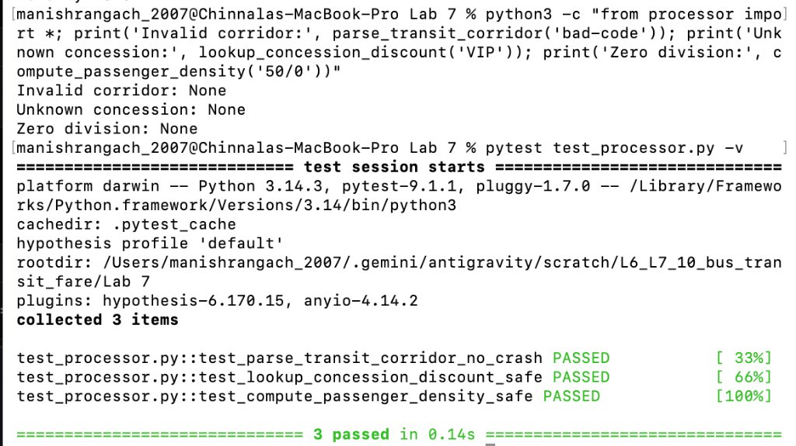

# LAB 07: Fuzzing for Input Validation Bugs

**Student Name:** Chinnala Manish Ranga  
**SRN:** PES2UG24CS135  
**Section:** 5C  
**Subject:** SE LAB 07  
**Submission Document:** [Lab_07_PES2UG24CS135.pdf](./Lab_07_PES2UG24CS135.pdf)  

---

## Overview

Lab 7 explores dynamic property-based fuzz testing as a security and quality assurance technique using Python's **Hypothesis** framework. We identify and resolve input validation vulnerabilities across three transit fare processing functions:
1. `parse_transit_corridor(corridor_code)`
2. `lookup_concession_discount(category_name)`
3. `compute_passenger_density(occupancy_ratio_str)`

---

## 📸 Output Terminal Screenshots

### Step 1: Running the Buggy Application
Running the starter application with baseline happy-path inputs:
- Corridor: `DT-UP-3` &rarr; `Route DT->UP: 3 Zones, Fare $4.75`
- Concession: `STUDENT` &rarr; `Multiplier: 0.5`
- Passenger Density: `50/10.0` &rarr; `Density: 5.0`

---

### Step 2: Fuzz Test Failures

#### 1. Fuzz Test Failures: `parse_transit_corridor`
Hypothesis discovered crashes on `s=''` (`ValueError: not enough values to unpack`) and `s=None` (`AttributeError: 'NoneType' object has no attribute 'strip'`):

#### 2. Fuzz Test Failures: `lookup_concession_discount`
Hypothesis discovered crashes on `s=''` (`KeyError: ''`) and `s=None` (`AttributeError: 'NoneType' object has no attribute 'strip'`):

#### 3. Fuzz Test Failures: `compute_passenger_density`
Hypothesis discovered crashes on `s='/'` (`ValueError: could not convert string to float: ''`), `s=''` (`ValueError: not enough values to unpack`), and `s=None` (`AttributeError: 'NoneType' object has no attribute 'split'`):

#### 4. Pytest Failure Summary
Confirmation of 3 failed tests in 0.59s during Hypothesis fuzz testing on the starter code:

---

### Step 3: Fixed Application Running (Edge Cases Handled)
Defensively refactored `processor.py` handling normal inputs and gracefully returning `None` on invalid inputs (`bad-code`, `VIP`, `50/0`) without crashing:

---

### Step 4: Verification, All Hypothesis Tests Passing
Re-running `pytest test_processor.py -v` against the fixed code: **all 3 tests PASSED in 0.14s** with 300 randomized fuzz trials and zero crashes:

---

## 📁 Files in this Directory

| File | Description |
|---|---|
| [`processor.py`](./processor.py) | Hardened, defensively programmed application script |
| [`test_processor.py`](./test_processor.py) | Completed Hypothesis property-based test suite |
| [`processor_buggy.py`](./processor_buggy.py) | Original buggy starter code for reference |
| [`Lab_07_PES2UG24CS135.pdf`](./Lab_07_PES2UG24CS135.pdf) | Complete 6-page submission PDF document with all screenshots |
| [`screenshots/`](./screenshots/) | Folder containing all 7 authentic terminal screenshots |
| [`submissions/`](./submissions/) | Directory with final PDF deliverables and screenshot assets |
